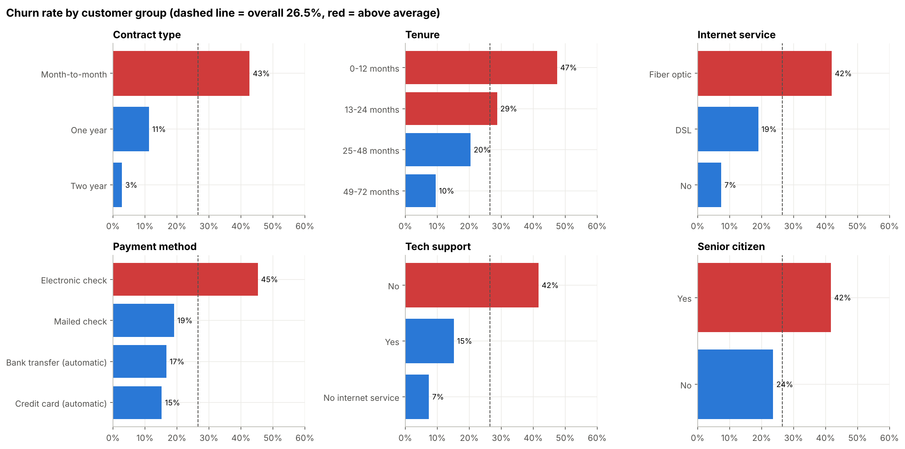
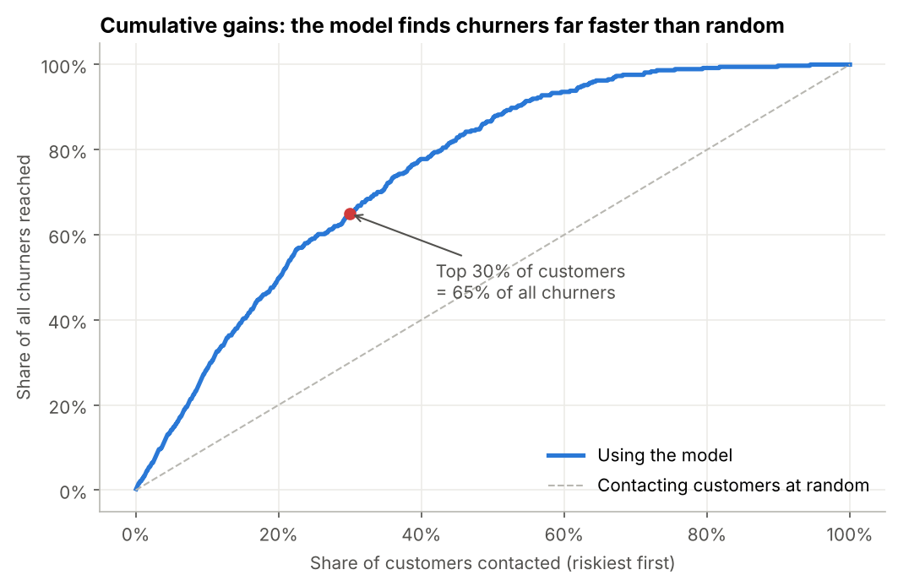
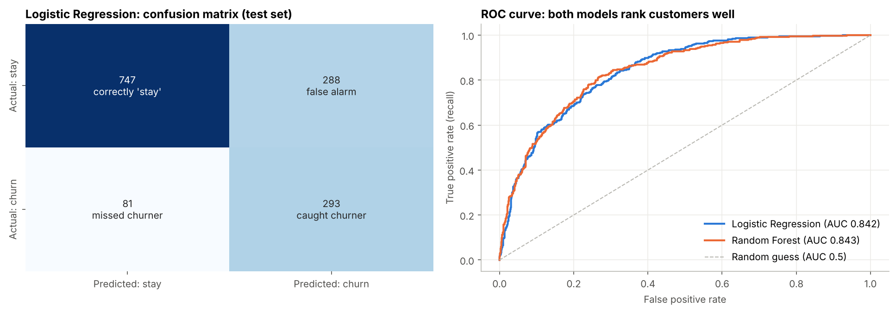

# Telecom Customer Churn: Analysis and Prediction

Why do telecom customers leave, and can we spot them before they do? I analysed 7,043 customers from the IBM Telco dataset, found the main churn drivers, and built a model that ranks customers by churn risk so a retention team knows who to contact first.

**Tools:** Python (pandas, NumPy, scikit-learn), Matplotlib, Seaborn, Jupyter
**Methods:** exploratory analysis, one-hot encoding, train/test split, Logistic Regression, Random Forest, precision/recall, ROC-AUC, cumulative gains

---

## Key findings

| # | Finding |
|---|---|
| 1 | **26.5%** of customers churned. |
| 2 | **Month-to-month** customers churn at **43%**, versus 11% (one-year) and 3% (two-year contracts). |
| 3 | **47%** of customers in their **first 12 months** churn; after 4 years it falls to 10%. |
| 4 | **Electronic check** payers churn at 45%; automatic payers at 15–17%. |
| 5 | **Fiber optic** users churn at 42%, and customers **without tech support** at 42%. |
| 6 | The model catches **78% of churners**, and contacting the **top 30% riskiest** customers reaches **65% of all churners**. |





---

## Model results (test set, 1,409 customers)

| Model | Accuracy | Precision | Recall | F1 | ROC-AUC |
|---|---|---|---|---|---|
| Baseline (always "stay") | 0.735 | 0.000 | 0.000 | 0.000 | 0.500 |
| **Logistic Regression** | 0.738 | 0.504 | **0.783** | 0.614 | **0.842** |
| Random Forest | 0.760 | 0.533 | 0.781 | 0.633 | 0.843 |

- The baseline gets 73.5% accuracy while catching **zero** churners, which is why I focus on **recall** and **ROC-AUC** instead of accuracy.
- I picked **Logistic Regression**: it has the same recall and practically the same ROC-AUC as Random Forest, and it's easier to explain to a business team.
- Both models use `class_weight="balanced"` because churners are only about a quarter of the data.



---

## Approach

**1. Cleaning**
- `TotalCharges` was stored as text. 11 rows had a blank value, and all of them had **tenure = 0** (new customers not billed yet), so I set them to 0 instead of dropping them or filling them with an average.

**2. EDA:** churn rate by contract, tenure, internet service, payment method, tech support and age group.

**3. Features**
- Dropped `customerID` and one-hot encoded the text columns (30 features).
- Stratified 80/20 train/test split.
- Scaled the numeric columns for Logistic Regression, with the scaler fitted on training data only to avoid leakage.

**4. Models:** a baseline, Logistic Regression and Random Forest, compared on precision, recall, F1 and ROC-AUC. I also show how precision and recall change with the decision threshold (0.3 to 0.7).

**5. Drivers:** Logistic Regression coefficients and Random Forest feature importance. Both agree that contract, tenure, fiber optic, electronic check and tech support/security matter most. `MonthlyCharges` gets a negative coefficient despite churners paying more, because of **multicollinearity** with the service columns. This is explained in the notebook.

**6. Action list:** customers scored as Low / Medium / High risk. Actual churn rate in the High group is **60.5%**, versus **7.0%** in the Low group.

---

## Recommendations

| Finding | Action |
|---|---|
| Month-to-month churn 43% | Discount to switch High-risk monthly customers to a 1-year contract |
| First year churn 47% | Onboarding check-ins in months 1 and 3 |
| Electronic check churn 45% | Small incentive to move to automatic payment |
| No tech support churn 42% | Free tech-support trial for High-risk customers |
| Fiber optic churn 42% | Review fiber pricing and service quality |

## Project structure

```
├── data/
│   └── WA_Fn-UseC_-Telco-Customer-Churn.csv    raw data (7,043 customers)
├── notebooks/
│   └── churn_analysis.ipynb                     full analysis + models
├── images/                                      charts
├── outputs/                                     model comparison, risk scores, churn by contract
└── requirements.txt
```

## How to run

```bash
git clone https://github.com/bhawna346/telco-customer-churn.git
cd telco-customer-churn
pip install -r requirements.txt
jupyter notebook notebooks/churn_analysis.ipynb
```

## Limitations
- One snapshot in time; no history of complaints, network quality or competitor offers.
- IBM sample data, so a real company would retrain on its own customers.
- Coefficients show association, not cause; retention offers should be A/B tested before rollout.

## Data source
[Telco Customer Churn](https://www.kaggle.com/datasets/blastchar/telco-customer-churn) (Kaggle, IBM sample dataset).
